# PaperTrail - AI Scientific Integrity & Literature Synthesis Platform

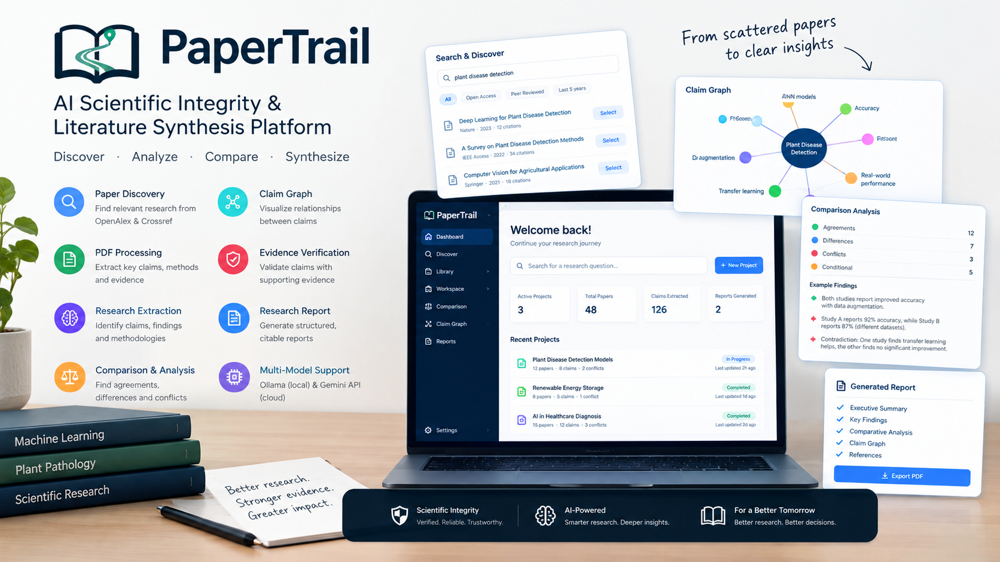

PaperTrail is an autonomous, scientific-integrity AI research assistant designed to orchestrate scholarly literature discovery, ingest research papers, extract structured empirical claims, audit evidence against source PDF text, detect cross-paper contradictions, and visualize findings in an interactive claim-to-evidence graph.


**Core Engine:** LangGraph Multi-Node Workflow Orchestrator + FastAPI + SQLite <br/>
**Frontend Stack:** Next.js 16 (Turbopack) + React 19 + TypeScript + Tailwind CSS v4 + React Flow (`@xyflow/react`) <br/>
**Extraction Providers:** Google Gemini (Cloud Structured JSON) & Local Ollama (`qwen2.5:1.5b`)

---

## Table of Contents

1. [Overview](#1-overview)
2. [Tech Stack](#2-tech-stack)
3. [Features](#3-features)
4. [Platform Walkthrough & Screenshots](#4-platform-walkthrough--screenshots)
5. [Using the Application & End-to-End Workflow](#5-using-the-application--end-to-end-workflow)
6. [System Architecture](#6-system-architecture)
7. [Database Design](#7-database-design)
8. [LangGraph Research Workflow & State Machine](#8-langgraph-research-workflow--state-machine)
9. [Scientific Integrity & Contradiction Engine](#9-scientific-integrity--contradiction-engine)
10. [Interactive Claim-to-Evidence Graph](#10-interactive-claim-to-evidence-graph)
11. [API Reference](#11-api-reference)
12. [Security & Guardrails](#12-security--guardrails)
13. [Local Setup Guide](#13-local-setup-guide)
14. [Environment Variables](#14-environment-variables)
15. [Testing & Verification](#15-testing--verification)
16. [Future Improvements](#16-future-improvements)

---

## 1. Overview

### The Problem
Scientific literature reviews suffer from human cognitive overload and LLM hallucinations. Researchers often struggle to:
- Manually correlate differing findings across dozens of 15-page PDFs.
- Distinguish genuine empirical contradictions from harmless variations in datasets, populations, or measurement units.
- Verify whether an AI summary is actually grounded in ground-truth document text or fabricated from training memory.
- Track workflow state across multi-step research extraction pipelines without silent failures.

### The Solution: PaperTrail
PaperTrail introduces an auditable, deterministic, multi-agent orchestration architecture:

> **Hypothesis & Scope Definition** ──► **Scholarly Discovery (OpenAlex / Crossref / PDF Upload)** ──► **Structured Claim Extraction** ──► **Cross-Paper Empirical Comparison** ──► **Ground-Truth Evidence Verification** ──► **Contradiction Classification** ──► **Interactive Knowledge Graph & Report Synthesis**

### Core Scientific Tenets
1. **Never Infer Contradiction Merely From Numeric Differences**: A 2% difference between models evaluated on disparate datasets is an experimental distinction, not an empirical conflict.
2. **Mandatory Grounded Quotes**: Every claim, metric, and limitation must be linked to exact verbatim passages and page numbers in the source paper.
3. **Auditability First**: The LLM's suggested relationship is provisional until verified against ground-truth document text by the verification engine.
4. **Deterministic Orchestration**: Orchestrated by a 10-node typed LangGraph state machine with bounded retries, state persistence, and idempotent re-execution.

---

## 2. Tech Stack

| Layer | Technology | Version | Purpose |
| :--- | :--- | :--- | :--- |
| **Frontend Framework** | Next.js (App Router, Turbopack) | `16.4.2` | High-performance client portal, streaming SSR, and UI state routing |
| **Frontend Runtime** | React | `19.3.0` | Reactive component model with compiler optimizations |
| **Language (Full-Stack)** | TypeScript / Python | `5.x` / `3.12+` | Strict end-to-end type safety across backend schemas and client interfaces |
| **Graph Visualization** | React Flow (`@xyflow/react`) | `12.4.4` | Interactive claim-to-evidence graph with custom node/edge rendering |
| **Styling & Icons** | Tailwind CSS v4 + Lucide React | `4.x` / `1.16+` | Elevated dark portal aesthetic, glassmorphic cards, seamless scrollbars |
| **Backend Framework** | FastAPI + Uvicorn | `0.146+` / `0.54+` | Async REST API, OpenAPI docs, bounded streaming, CORS middleware |
| **Workflow Engine** | LangGraph + LangChain Core | `1.2+` / `1.7+` | Multi-node stateful DAG orchestration, conditional branching, retries |
| **Persistence Engine** | SQLite3 + WAL mode | `3.x` | Zero-config relational persistence, foreign keys, non-destructive migrations |
| **PDF Processing** | PyMuPDF (`fitz`) | `1.28.2` | Byte validation, magic header verification, streaming page text extraction |
| **LLM Inference (Cloud)** | Google Gemini API (`google-genai`) | `gemini-2.5-flash` | Ultra-fast structured claim extraction and JSON schema adherence |
| **LLM Inference (Local)** | Ollama REST Client | `qwen2.5:1.5b` | 100% private, offline, bounded local model inference |
| **Scholarly Upstreams** | OpenAlex & Crossref REST APIs | Live | Literature discovery, metadata harvesting, and open-access PDF resolution |

---

## 3. Features

### Literature Discovery & Ingestion
- **Scholarly Search Aggregator**: Queries OpenAlex and Crossref simultaneously with year filtering, publication limit caps, and local memory caching.
- **Safe Binary PDF Ingestion**: Enforces 20 MB bounded chunk uploads, checks `%PDF-` magic bytes, prevents path traversal, and extracts text page-by-page.
- **Abstract & Full-Text Materialization**: Automatically materializes open-access paper text into SQLite page records so papers can be analyzed with or without local PDF uploads.

### LangGraph Research Orchestration
- **Explicit Typed State**: Strongly typed `ResearchAnalysisState` passing validated papers, pending documents, extraction schemas, conflict matrices, and retry records.
- **Idempotent Execution**: Rerunning analysis on an existing project reuses valid extractions and updates existing records without creating duplicates.
- **Controlled Failure & Bounded Retries**: Avoids infinite loops with configurable per-node retry ceilings (default: 2 retries). If a stage fails irreparably, state transitions into `record_failure` with actionable diagnostic messages.
- **Static Graph Inspection**: Live endpoint (`/api/analysis/graph`) exposing graph structure, nodes, directed edges, conditional branches, and Mermaid diagrams.

### Scientific Integrity & Contradiction Analysis
- **Empirical Compatibility Checking**: Evaluates compatibility across Research Questions, Populations/Datasets, Methodologies, and Metrics before comparing findings.
- **Rigorous Classification**: Assigns strict relationship labels: `potential_contradiction`, `agreement`, `conditional_difference`, `extension`, `incomparable`, or `unresolved`.
- **Ground-Truth Evidence Verification**: Verifies cited quotes and page references against the raw physical document text stored in the SQLite database to eliminate hallucinations.

### Interactive Claim-to-Evidence Graph
- **React Flow Canvas**: Graph visualizer displaying Papers, Claims, Evidence Passages, Datasets, Methods, and Evaluation Metrics as distinct node types.
- **Directed Semantic Edges**: Renders verified relationships including *supported by*, *reported by*, *agrees with*, *potentially contradicts*, *uses dataset*, and *evaluated using*.
- **Visual Tension Differentiation**: Clear color and stroke styling distinguishing verified potential contradictions from supporting evidence.
- **Node Details Inspector**: Slide-out drawer showing verbatim page quotes, DOI links, and direct links to original PDF documents.

### Executive Research Synthesis
- **Structured Synthesis Report**: Executive summaries, reviewed paper catalogs, comparative analysis tables, conflict reconciliations, limitations, and future directions.
- **Modal & Full-Screen Views**: Open instant synthesis overlay directly by clicking any project title from the Dashboard, or navigate to the dedicated Report tab with one-click clipboard copying.

---

## 4. Platform Walkthrough & Screenshots

| Screenshot Placeholder | Description |
| :--- | :--- |
| 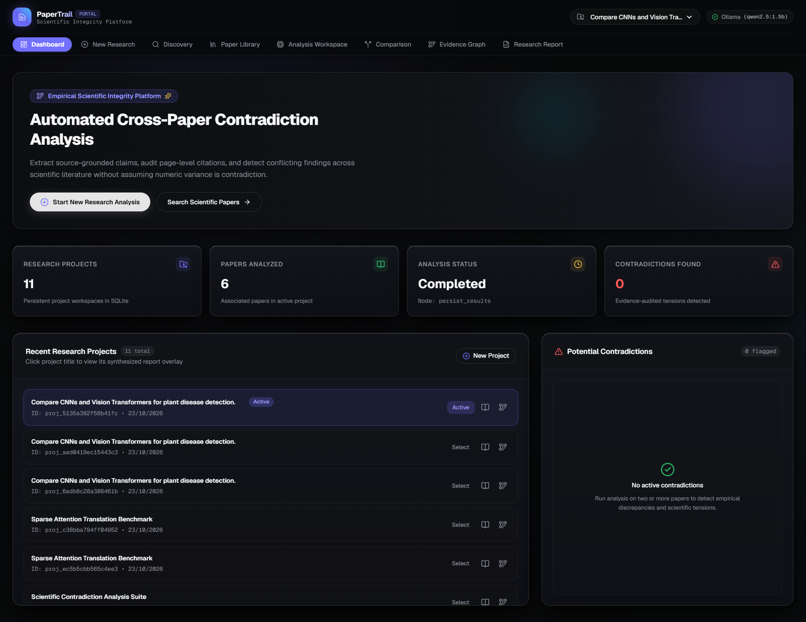 | **Dashboard** — Central research command center displaying active metrics, synchronized fixed-height project lists, and flagged contradictions. |
| 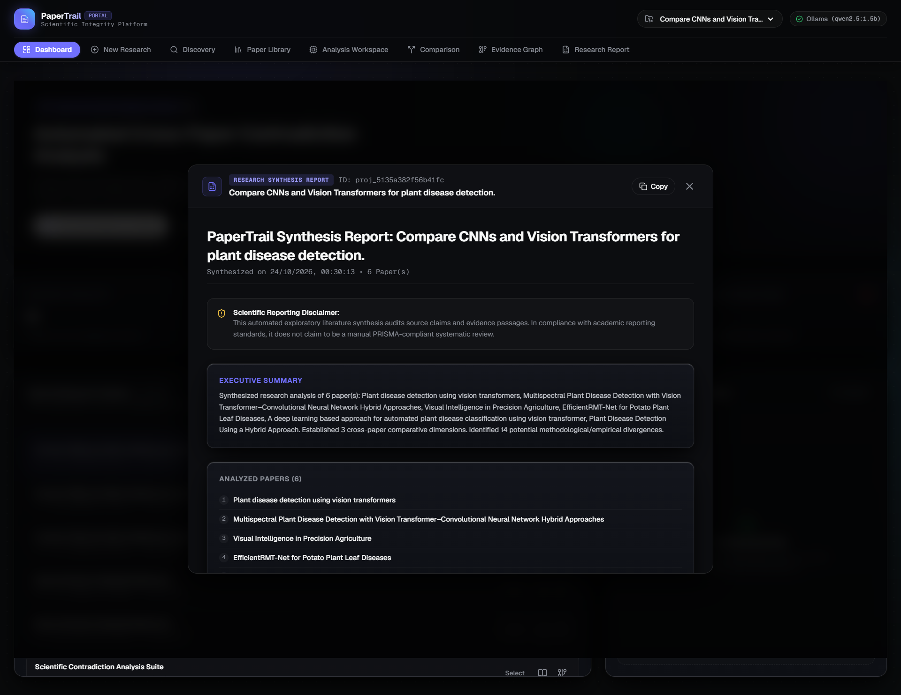 | **Project Report Overlay** — Instant synthesis modal triggered by clicking any project title; presents full executive summary, comparative matrices, and limitations without leaving the dashboard. |
| 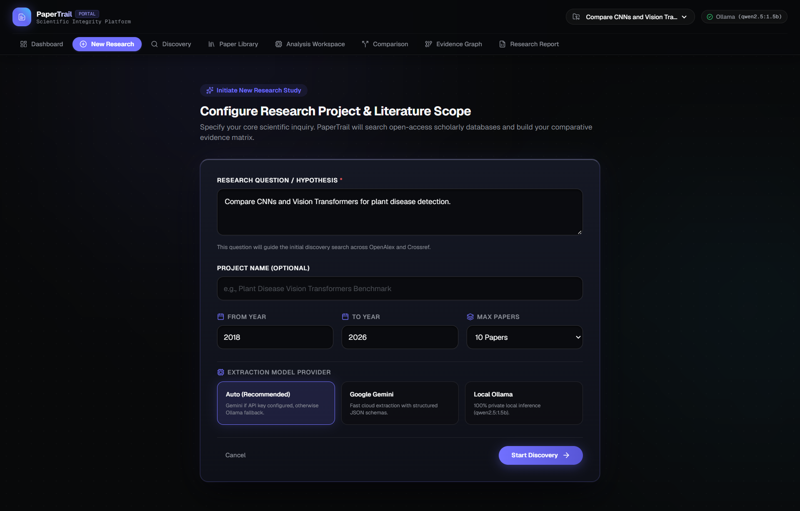| **New Research Scope** — Formulates research hypothesis, configures publication year range, paper limit caps, and selects Gemini or local Ollama extraction. |
| 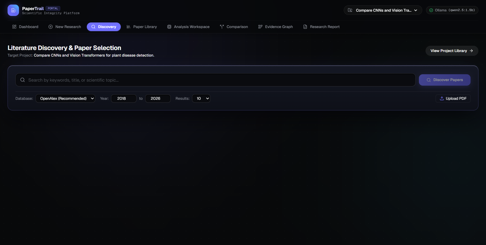 | **Literature Discovery** — Queries open scholarly databases, provides multi-select paper curation cards, and supports direct drag-and-drop PDF uploads. |
| 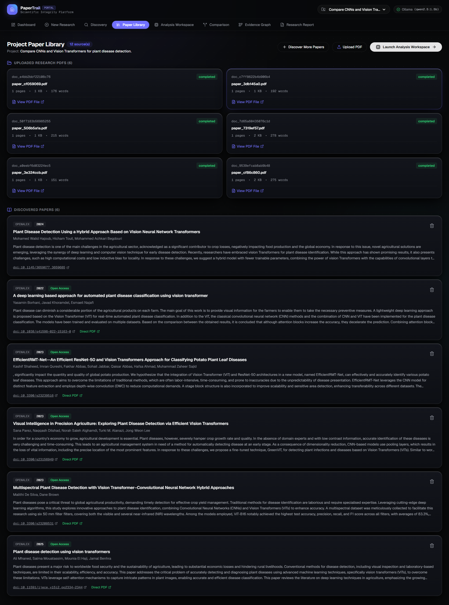 | **Paper Library** — Comprehensive catalog of all papers and uploaded PDF documents bound to the active project with character counts, DOIs, and metadata. |
| 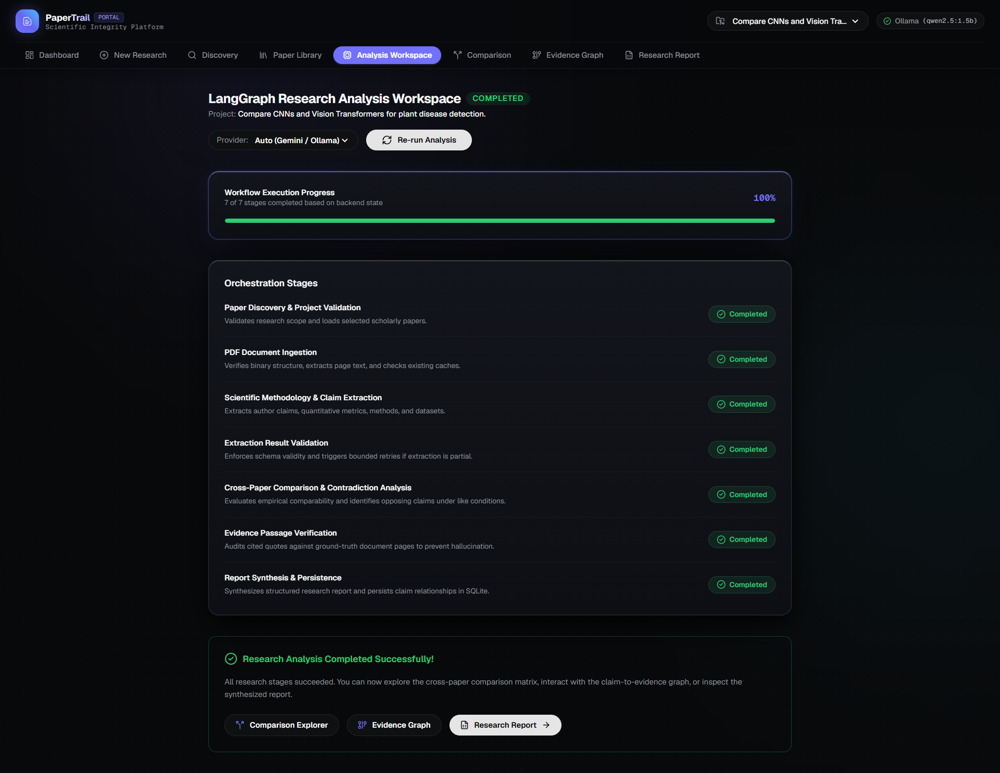| **Analysis Workspace** — Live 7-stage workflow tracker displaying real progress percentage, active node execution, retry counters, and diagnostic logs. |
| 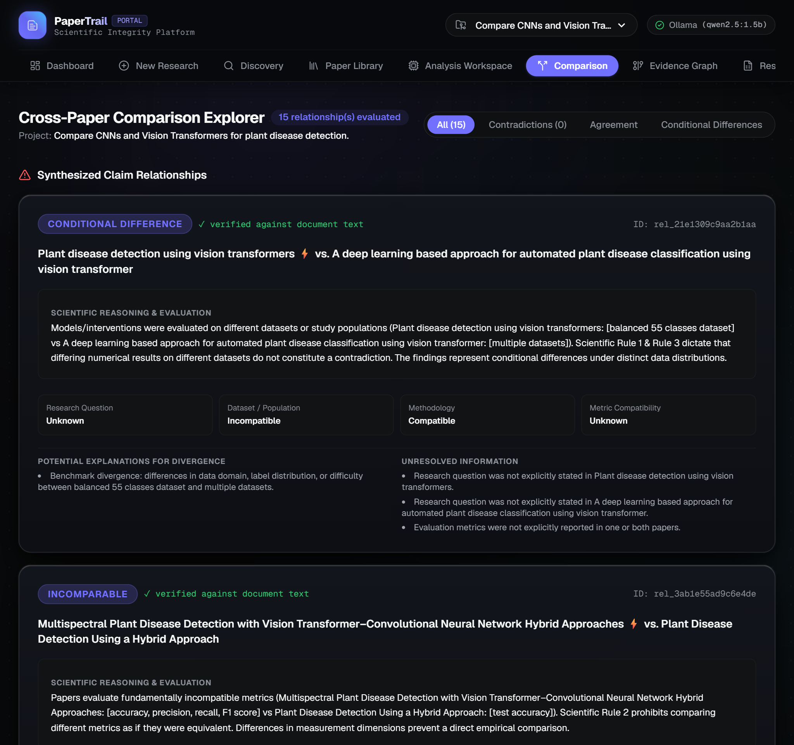 | **Comparison Explorer** — Side-by-side empirical alignment matrix comparing author claims, datasets, experimental setups, and quantitative metrics. |
| 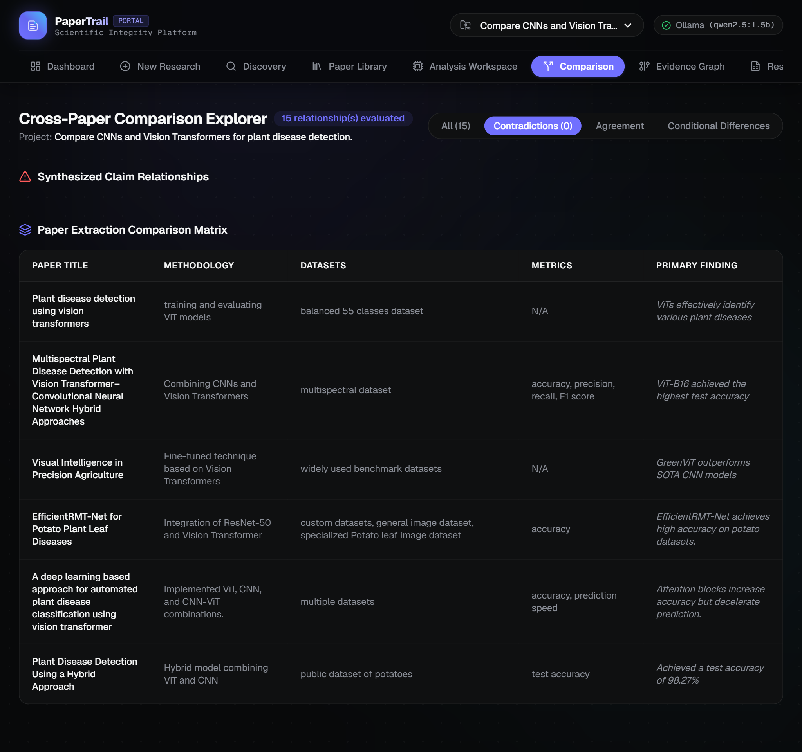| **Contradiction Audit Cards** — Filterable cards highlighting potential contradictions, underlying compatibility analyses, and supporting rationale. |
| 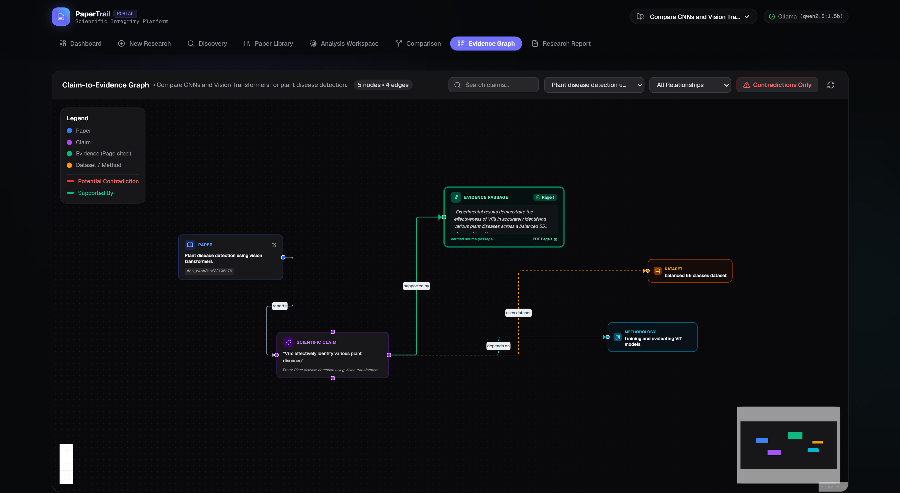 | **Interactive Evidence Graph** — React Flow canvas visualizing directional relationships between papers, author claims, ground-truth evidence, and datasets. |
|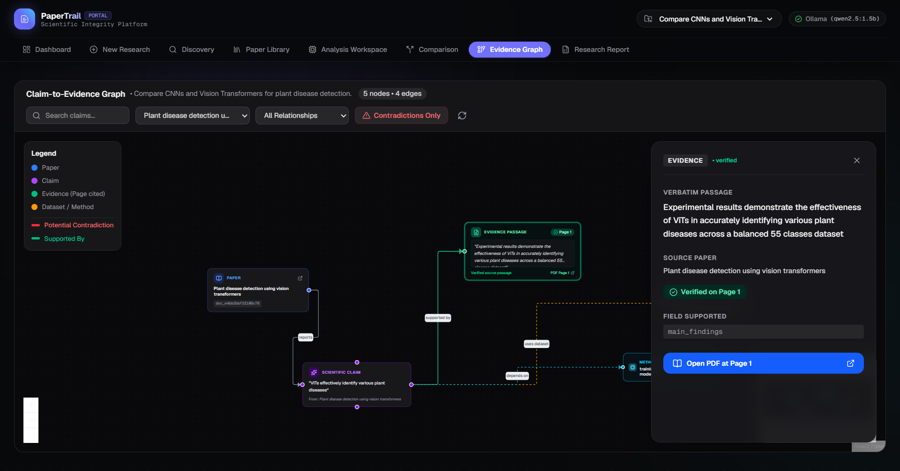 | **Node Details Inspector** — Contextual slide-out panel showing exact page citations, verbatim quotes, and direct PDF view links upon node selection. |
| 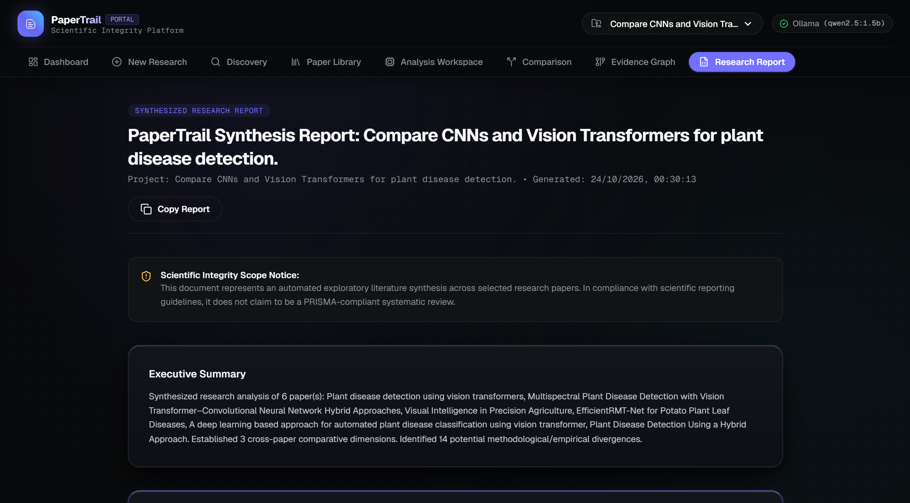| **Research Report Screen** — Formatted research review document complete with Markdown export, conflict reconciliations, and evidence-audited citations. |
| 

---

## 5. Using the Application & End-to-End Workflow

Follow this step-by-step workflow to explore PaperTrail from hypothesis formulation to synthesized graph analysis:

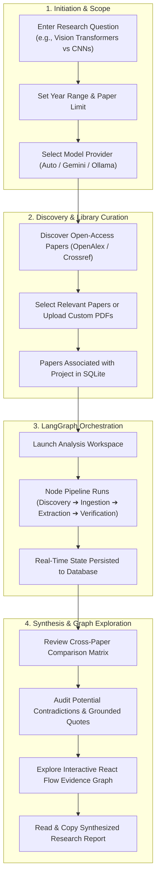

### Step 1: Create a Research Scope
1. Navigate to **New Research**.
2. Enter your research question or hypothesis (e.g., *"Compare CNNs and Vision Transformers for plant disease detection"*).
3. Set your publication year bounds (e.g., 2019 to 2026) and maximum paper count.
4. Choose your LLM extraction provider:
   - **Auto (Recommended)**: Uses Gemini if `GEMINI_API_KEY` is configured; otherwise falls back to local Ollama.
   - **Google Gemini**: High-speed cloud extraction with guaranteed JSON schema validation.
   - **Local Ollama**: 100% private local offline inference (`qwen2.5:1.5b`).
5. Click **Start Discovery**.

### Step 2: Curate Literature & Ingest Documents
1. Review the papers retrieved from OpenAlex and Crossref.
2. Select candidate papers with the checkboxes or click **Select All**.
3. Click **Add Selected Paper(s) to Project**.
4. *(Optional)* Upload custom research PDFs via the PDF drop-zone in the Discovery or Library screens.
5. In **Paper Library**, verify your paper corpus (at least 2 papers are required for cross-paper comparative analysis).
6. Click **Launch Analysis Workspace**.

### Step 3: Execute the LangGraph Workflow
1. Click **Start Research Analysis**.
2. Observe the live execution progress across all 7 pipeline stages:
   - Validating project scope and loading papers.
   - Ingesting and extracting page-by-page text.
   - Structured claim, method, dataset, and metric extraction.
   - Cross-paper comparison preparation.
   - Conflict analysis and tension auditing.
   - Ground-truth evidence verification against raw document text.
   - Final report synthesis and SQLite persistence.

### Step 4: Explore Comparisons, Contradictions, and Evidence Graph
1. Open **Comparison Explorer** to inspect the side-by-side empirical alignment matrix.
2. Filter relationships by **Potential Contradictions**, **Agreements**, or **Conditional Differences**.
3. Open **Evidence Graph** to interact with the multi-node React Flow canvas:
   - Pan and zoom across the knowledge network.
   - Filter nodes by Papers, Claims, Evidence, Datasets, or Methods.
   - Toggle contradiction edges to isolate empirical disputes.
   - Click any node to open the **Node Details Drawer** with verbatim quotes, page numbers, and PDF view links.
4. Navigate to **Research Report** (or click the project title on the Dashboard) to view the complete synthesized literature review and export it to Markdown.

---

## 6. System Architecture

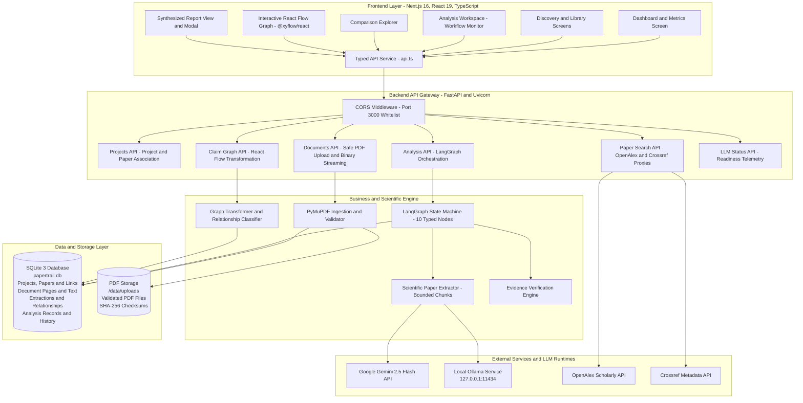

---

## 7. Database Design

PaperTrail utilizes a persistent, normalized SQLite database configured with foreign keys and WAL mode. Schema migrations are non-destructive and managed automatically on startup:

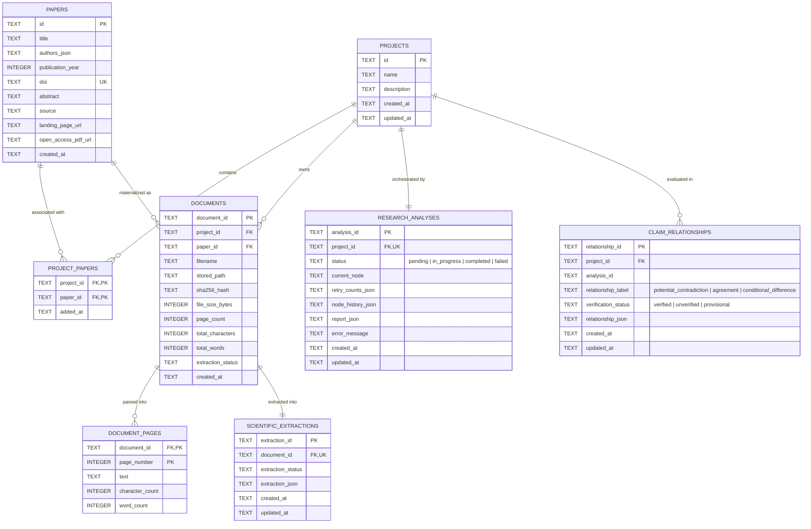

---

## 8. LangGraph Research Workflow & State Machine

The research workflow is modeled as a compiled state graph using **LangGraph**:

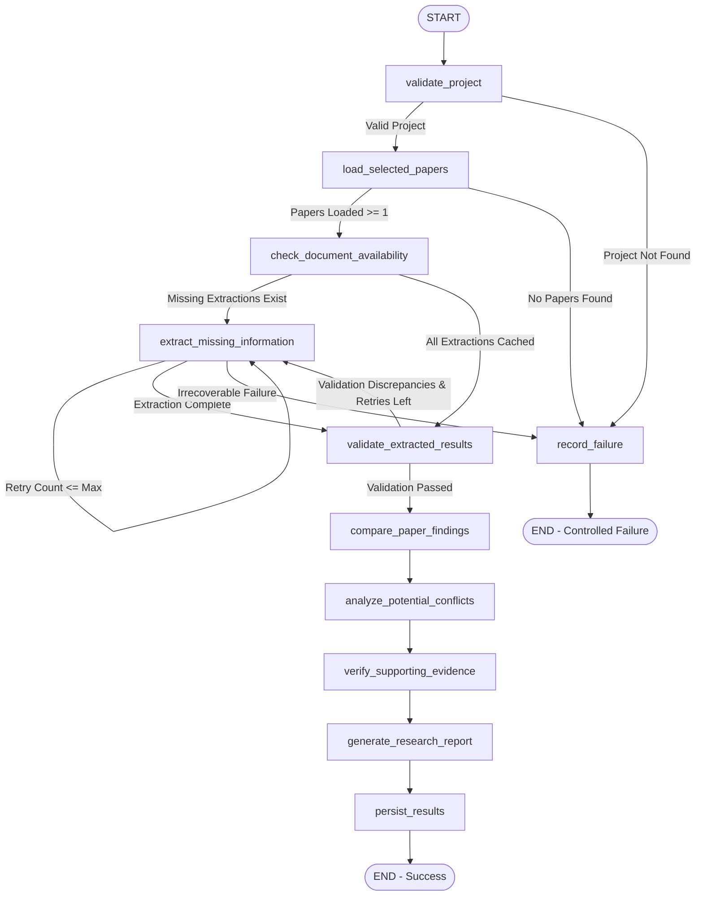

### Graph Execution Nodes
1. **`validate_project`**: Verifies that the target project ID exists in the database.
2. **`load_selected_papers`**: Queries all papers linked via `project_papers`.
3. **`check_document_availability`**: Inspects `documents` and cached `scientific_extractions`. If a paper has an abstract but no uploaded PDF, it materializes document records and page text automatically.
4. **`extract_missing_information`**: Invokes the configured LLM (Gemini or Ollama) with bounded chunking to extract author claims, methods, datasets, metrics, and quantitative results.
5. **`validate_extracted_results`**: Validates the extracted payload against the strict Pydantic `ScientificPaperExtraction` schema.
6. **`compare_paper_findings`**: Pairs extracted claims and assesses compatibility across research inquiries, populations, and experimental parameters.
7. **`analyze_potential_conflicts`**: Classifies relationships between claims and drafts supporting explanations for observed tensions.
8. **`verify_supporting_evidence`**: Audits quoted evidence against the actual text stored in `document_pages` to confirm verbatim fidelity.
9. **`generate_research_report`**: Synthesizes a structured `ResearchReport` containing executive summaries, comparative tables, and conflict reconciliations.
10. **`persist_results`**: Persists the final report, node history, and individual `ClaimRelationship` records to SQLite idempotently.
11. **`record_failure`**: Handles recoverable and terminal exceptions gracefully, logging the failure node and diagnostic details.

---

## 9. Scientific Integrity & Contradiction Engine

A core differentiator of PaperTrail is its adherence to strict scientific rules when evaluating claims across papers:

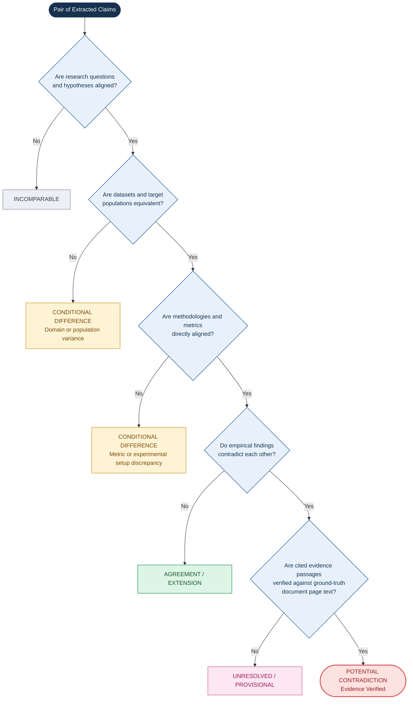

### Allowed Relationship Labels
- **`potential_contradiction`**: Opposing empirical claims observed under like conditions and comparable evaluation metrics.
- **`agreement`**: Consistent, corroborating findings reached independently.
- **`conditional_difference`**: Differing numeric outcomes resulting from disparate datasets, environments, or parameter settings.
- **`extension`**: One study expands upon, scales, or refines another study's methodology.
- **`incomparable`**: Incompatible research goals, metrics, or experimental methodologies that prevent meaningful correlation.
- **`unresolved`**: Available evidence is insufficient to substantiate either agreement or contradiction.

---

## 10. Interactive Claim-to-Evidence Graph

PaperTrail renders interactive graph visualizations powered by **React Flow** (`@xyflow/react`):

### Graph Node Classification

| Node Type | Icon Badge | Visual Styling | Represents |
| :--- | :---: | :--- | :--- |
| **Paper** | `BookOpen` | Deep Slate / Violet Border | A scholarly paper included in the analysis corpus |
| **Claim** | `Sparkles` | Indigo Background | An author claim extracted from paper findings |
| **Evidence** | `FileText` | Emerald Green Tint | Verbatim source passage with verified page number citation |
| **Dataset** | `Database` | Amber Gold Border | Benchmark dataset, corpus, or target population used |
| **Method** | `Cpu` | Cyan Blue Accent | Experimental architecture, baseline, or algorithmic approach |
| **Metric** | `BarChart2` | Pink / Rose Tint | Quantitative evaluation metric (e.g., Accuracy, F1, BLEU) |

### Graph Edge Classification
- **`supported_by`**: Links a Claim to its Ground-Truth Evidence Passage.
- **`reported_by`**: Links a Claim to its Source Paper.
- **`uses_dataset`**: Directed link from Paper/Method to Dataset.
- **`evaluated_using`**: Directed link from Paper to Metric.
- **`potentially_contradicts`**: High-contrast, highlighted directional edge connecting two conflicting claims.
- **`agrees_with`**: Corroborating directional link connecting mutually supportive claims.

---

## 11. API Reference

All backend routes are documented interactively via Swagger UI at `http://localhost:8000/docs`.

### Projects & Papers

| Method | Endpoint | Description |
| :--- | :--- | :--- |
| `GET` | `/api/projects` | List all persisted research projects |
| `POST` | `/api/projects` | Create a new research project |
| `GET` | `/api/projects/{id}` | Get project details, associated papers, and documents |
| `DELETE` | `/api/projects/{id}` | Delete project with cascading document and analysis cleanup |
| `POST` | `/api/projects/{id}/papers` | Associate a scholarly paper with a project |
| `DELETE` | `/api/projects/{id}/papers/{paper_id}` | Remove paper from project |
| `GET` | `/api/papers/search` | Query OpenAlex and Crossref with query caching |

### Documents & PDF Storage

| Method | Endpoint | Description |
| :--- | :--- | :--- |
| `POST` | `/api/projects/{id}/documents` | Upload, validate, and extract a research PDF for a project |
| `GET` | `/api/projects/{id}/documents` | List uploaded PDF document metadata for a project |
| `GET` | `/api/documents/{id}/file` | Stream physical PDF file for in-browser inspection |
| `GET` | `/api/documents/{id}/extraction` | Get persisted structured extraction for a document |

### Analysis & Interactive Graph

| Method | Endpoint | Description |
| :--- | :--- | :--- |
| `GET` | `/api/analysis/graph` | Inspect the static LangGraph workflow structure (nodes, edges, Mermaid) |
| `POST` | `/api/projects/{id}/analysis` | Execute the research workflow pipeline (async or sync) |
| `GET` | `/api/projects/{id}/analysis` | Get live analysis status, progress, and synthesized report |
| `GET` | `/api/projects/{id}/relationships`| List evaluated cross-paper claim relationships |
| `GET` | `/api/projects/{id}/claim-graph` | Fetch transformed React Flow node-and-edge graph payload |
| `GET` | `/api/llm/status` | Check Gemini API and local Ollama inference service health |

#### Example: Start Project Analysis
```http
POST /api/projects/proj_01j9x2k/analysis?provider=auto HTTP/1.1
Host: localhost:8000
Content-Type: application/json
```

**Response (`200 OK`)**:
```json
{
  "analysis_id": "analysis_proj_01j9x2k",
  "project_id": "proj_01j9x2k",
  "status": "completed",
  "current_node": "persist_results",
  "retry_counts": {
    "extract_missing_information": 0,
    "validate_extracted_results": 0
  },
  "node_history": [
    { "node": "validate_project", "status": "completed" },
    { "node": "load_selected_papers", "status": "completed" },
    { "node": "check_document_availability", "status": "completed" },
    { "node": "extract_missing_information", "status": "completed" },
    { "node": "validate_extracted_results", "status": "completed" },
    { "node": "compare_paper_findings", "status": "completed" },
    { "node": "analyze_potential_conflicts", "status": "completed" },
    { "node": "verify_supporting_evidence", "status": "completed" },
    { "node": "generate_research_report", "status": "completed" },
    { "node": "persist_results", "status": "completed" }
  ],
  "report": {
    "report_id": "rep_9f82bc",
    "title": "Synthesis: Vision Transformers vs CNNs in Plant Pathology",
    "executive_summary": "Comparative analysis across 4 benchmark evaluations...",
    "paper_count": 4,
    "papers_reviewed": ["Paper A (2023)", "Paper B (2024)"]
  }
}
```

---

## 12. Security & Guardrails

- **No Arbitrary Shell or Code Execution**: LLM outputs are strictly constrained to Pydantic schemas. Model responses are never executed as code or shell commands.
- **Bounded Ingestion**: Enforces strict 20 MB maximum PDF size limits, validates `%PDF-` file magic headers, and reads in 64 KB chunks to protect memory.
- **Sanitized Filenames**: Strips directory traversals (`..`), control characters, and unsafe symbols on PDF upload.
- **Path Isolation**: Files are stored in a dedicated managed storage directory (`/data/uploads`) using SHA-256 hashes.
- **Air-Gapped & Local Inference Support**: Supports local Ollama instances (`qwen2.5:1.5b`) with zero telemetry or cloud dependencies for proprietary scientific data.

---

## 13. Local Setup Guide

### Prerequisites
- **Node.js**: v18.17+ or v20+
- **Python**: v3.12+
- **Git**
- *(Optional)* **Ollama**: Installed and running if using local offline inference (`ollama run qwen2.5:1.5b`)

---

### Step-by-Step Installation

#### 1. Clone Repository
```bash
git clone https://github.com/priyanshu09102003/papertrail_agentic_research_paper_tool
cd papertrail
```

#### 2. Configure Backend Virtual Environment & Dependencies
```bash
cd backend

# Create Python virtual environment
python -m venv .venv

# Activate virtual environment
# On Windows (PowerShell):
.\.venv\Scripts\Activate.ps1
# On Linux/macOS:
source .venv/bin/activate

# Install required dependencies
pip install -r requirements.txt
```

#### 3. Configure Backend Environment Variables
```bash
# In the backend directory:
cp .env.example .env
# Edit .env and configure GEMINI_API_KEY if using cloud extraction (or leave blank for Ollama)
```

#### 4. Run the Backend API Server
```bash
# Start backend server on port 8000
uvicorn app.main:app --reload --port 8000
```
*The backend API and Swagger docs will be available at `http://localhost:8000/docs`.*

#### 5. Configure & Start the Next.js Frontend
Open a new terminal window:
```bash
cd ../frontend

# Install node dependencies
npm install

# Start Next.js development server with Turbopack
npm run dev
```

#### 6. Open the Portal
Open **[http://localhost:3000](http://localhost:3000)** in your browser.

---

## 14. Environment Variables

Create a `.env` file in the `backend/` directory based on the following template:

```env
# ==============================================================================
# PaperTrail Backend Configuration
# ==============================================================================

# Fast Cloud Extraction LLM (Google Gemini API)
# Optional: If omitted, PaperTrail automatically falls back to local Ollama
GEMINI_API_KEY=""
GEMINI_MODEL="gemini-2.5-flash"
GEMINI_TIMEOUT_SECONDS=30.0

# Local Offline LLM (Ollama)
OLLAMA_BASE_URL="http://127.0.0.1:11434"
OLLAMA_MODEL="qwen2.5:1.5b"
OLLAMA_TIMEOUT_SECONDS=300.0

# Scholarly Discovery Upstreams
OPENALEX_BASE_URL="https://api.openalex.org"
CROSSREF_BASE_URL="https://api.crossref.org"

# Storage & Upload Limits
MAX_PDF_UPLOAD_SIZE_MB=20
```

Frontend environment variables (optional, in `frontend/.env.local`):
```env
NEXT_PUBLIC_API_URL="http://localhost:8000"
```

---

## 15. Testing & Verification

PaperTrail includes automated test suites covering backend graph workflows, PDF ingestion, extraction schemas, and frontend type safety:

```bash
# 1. Run all backend tests (LangGraph, PyMuPDF, Claim Graph, Repositories)
cd backend
.\.venv\Scripts\pytest.exe -v

# 2. Run backend workflow-specific tests
.\.venv\Scripts\pytest.exe tests/test_graph_workflow.py -v

# 3. Run frontend TypeScript verification (Zero Type Errors)
cd ../frontend
npx tsc --noEmit

# 4. Build frontend for production
npm run build
```

---

## 16. Future Improvements

1. **Vector Embedding Layer**: ChromaDB / FAISS integration for sub-paragraph dense semantic passage retrieval.
2. **Multi-Model Consensus Auditing**: Cross-validating contradictory claim candidates simultaneously across Gemini, Claude, and local deep-reasoning models.
3. **BibTeX & Zotero Sync**: Direct two-way sync with Zotero collections and automated BibTeX citation export.
4. **Equation & Table Parser**: OCR support for mathematical formulas and tabular comparisons in complex experimental PDFs.
